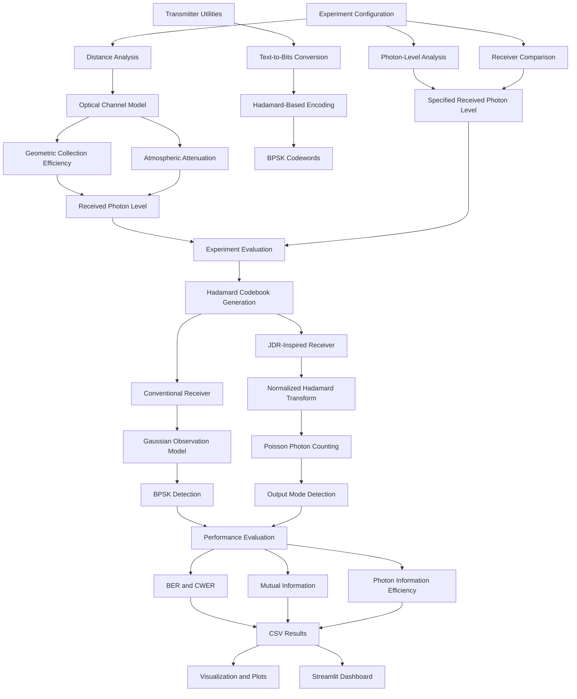

# Quantum-Assisted Optical Wireless Communication

## Simulation-Based Study of Joint Detection for Photon-Starved Optical Communication

## Project Overview

This project investigates a Joint Detection Receiver (JDR)-inspired optical communication model for smart industrial networks.

The study compares a conventional receiver with a simplified Hadamard-transform-based JDR-inspired model under photon-starved communication conditions.

The implementation is numerical and simulation-based. It does not implement a physical optical JDR or use quantum hardware.

## Objectives

- Generate Hadamard matrices and verify their orthogonality.
- Encode binary data using Hadamard-based BPSK codewords.
- Model optical transmission and photon budgets.
- Simulate conventional and JDR-inspired receivers.
- Evaluate Bit Error Rate (BER) and Codeword Error Rate (CWER).
- Estimate mutual information.
- Calculate Photon Information Efficiency (PIE).
- Study performance under different photon levels and transmission distances.
- Visualize simulation results using an interactive Streamlit dashboard.

## Technologies Used

| Technology | Purpose |
|---|---|
| Python | Core implementation |
| NumPy | Numerical computations and matrix operations |
| SciPy | Scientific computing |
| Pandas | Dataset handling and analysis |
| Matplotlib | Plot generation |
| Plotly | Interactive visualizations |
| Streamlit | Interactive dashboard |
| Pytest | Unit testing |

## Project Structure

```text
Quantum-Factory-Communication/
│
├── app.py
├── README.md
├── requirements.txt
├── .gitignore
│
├── src/
│   ├── __init__.py
│   ├── hadamard.py
│   ├── transmitter.py
│   ├── channel.py
│   ├── conventional_receiver.py
│   ├── jdr_receiver.py
│   ├── capacity.py
│   └── evaluation.py
│
├── experiments/
│   ├── __init__.py
│   ├── photon_analysis.py
│   ├── receiver_comparison.py
│   └── distance_analysis.py
│
├── visualization/
│   ├── __init__.py
│   └── plots.py
│
├── tests/
│   ├── test_hadamard.py
│   ├── test_transmitter.py
│   ├── test_channel.py
│   ├── test_receivers.py
│   └── test_evaluation.py
│
├── results/
│   ├── photon_analysis.csv
│   ├── receiver_comparison.csv
│   ├── distance_analysis.csv
│   └── plots/
│       ├── ber_vs_photons.png
│       ├── mutual_information_vs_photons.png
│       ├── pie_vs_photons.png
│       ├── ber_vs_distance.png
│       ├── mutual_information_vs_distance.png
│       └── pie_vs_distance.png
│
└── assets/
```

## System Architecture

The project consists of experiment configuration, Hadamard codeword generation, receiver simulation, performance evaluation and visualization.

The transmitter utilities provide binary encoding and Hadamard-based BPSK codeword generation. The distance experiment additionally uses the optical channel model to estimate received photon levels.

### Simulation Workflow

1. Configure the experiment and its photon-level or distance parameters.
2. Generate Hadamard matrices and codewords.
3. Estimate received photon levels using the optical channel model where required.
4. Process codewords through the conventional and JDR-inspired receiver models.
5. Evaluate receiver performance using BER, CWER, mutual information and PIE.
6. Store experimental results in CSV files.
7. Generate plots and visualize the results through the Streamlit dashboard.

### Architecture Diagram



## Methodology

### 1. Hadamard Matrix Generation

Hadamard matrices are generated using the Sylvester recursive construction.

Starting with:

\[
H_1 = [1]
\]

The recursive construction is:

\[
H_{2N} =
\begin{bmatrix}
H_N & H_N \\
H_N & -H_N
\end{bmatrix}
\]

The orthogonality property is:

\[
HH^T = NI
\]

This property allows the generation of mutually orthogonal codewords.

### 2. BPSK Encoding

Binary data is mapped to Binary Phase Shift Keying (BPSK) symbols:

\[
0 \rightarrow +1,\qquad 1 \rightarrow -1
\]

Groups of binary bits are used to select Hadamard codeword indices.

### 3. Optical Channel Modelling

The transmitted photon count per symbol is estimated using:

\[
N_t = \frac{P_t\lambda}{R_s hc}
\]

Where:

- \(P_t\): Transmitted optical power
- \(\lambda\): Optical wavelength
- \(R_s\): Symbol rate
- \(h\): Planck's constant
- \(c\): Speed of light

The simplified optical channel model incorporates:

- Geometric collection efficiency
- Atmospheric attenuation
- Optical efficiency
- Background photon contributions

A uniform circular beam approximation is used to estimate geometric collection efficiency.

### 4. Conventional Receiver

The conventional receiver uses a simplified normalized Gaussian BPSK observation model:

\[
y = 2\sqrt{\mu}s+n
\]

Where:

- \(\mu\): Mean received signal photons per symbol
- \(s\): Transmitted BPSK symbol
- \(n\): Gaussian noise

An illustrative background-dependent noise variance approximation is included.

The receiver detects the transmitted symbol based on the sign of the observation.

### 5. JDR-Inspired Receiver

The JDR-inspired receiver applies a normalized Hadamard transformation:

\[
U_H = \frac{H}{\sqrt{N}}
\]

For an ideal Hadamard codeword:

\[
U_H H_i^T = \sqrt{N}e_i
\]

The transformation concentrates the signal into its corresponding output mode.

Photon counts are sampled using Poisson distributions. The receiver identifies the output mode with the maximum photon count. Ties between maximum-count modes are resolved randomly.

This represents a simplified numerical model inspired by collective optical detection.

It should not be interpreted as a physical implementation of an optical joint detection receiver.

## Experimental Analysis

Three experiments are implemented to investigate receiver performance under different communication conditions.

### 1. Photon-Level Analysis

This experiment investigates how varying the mean received photon level per symbol affects receiver performance.

Photon levels:

- 0.05
- 0.1
- 0.2
- 0.5
- 1.0
- 2.0
- 5.0

The experiment evaluates:

- Bit Error Rate
- Mutual Information
- Photon Information Efficiency

**Output:**

`results/photon_analysis.csv`

### 2. Receiver Comparison

This experiment compares the conventional and JDR-inspired receiver models at selected photon levels.

The experiment evaluates:

- Bit Error Rate
- Codeword Error Rate
- Mutual Information
- Photon Information Efficiency

**Output:**

`results/receiver_comparison.csv`

### 3. Distance-Based Analysis

This experiment investigates the effect of transmission distance on received photon levels and receiver performance.

The experiment uses a reference-calibrated photon model:

- Reference distance: 100 m
- Reference received photon level: 0.5 photons per symbol

Other distances are scaled using relative geometric and atmospheric channel efficiencies.

**Output:**

`results/distance_analysis.csv`

## Evaluation Metrics

### 1. Bit Error Rate (BER)

BER measures the fraction of transmitted bits that are incorrectly decoded.

\[
BER =
\frac{\text{Number of Incorrect Bits}}
{\text{Total Transmitted Bits}}
\]

A lower BER indicates better bit-level communication reliability.

### 2. Codeword Error Rate (CWER)

CWER measures the fraction of transmitted codewords that are incorrectly identified.

\[
CWER =
\frac{\text{Incorrectly Decoded Codewords}}
{\text{Total Transmitted Codewords}}
\]

### 3. Mutual Information

Mutual information measures the information shared between transmitted and detected messages.

\[
I(X;Y) =
\sum_{x,y} p(x,y)
\log_2\left(
\frac{p(x,y)}{p(x)p(y)}
\right)
\]

It is estimated from the simulated transition probability matrix using a uniform input distribution.

The reported value is mutual information for the simulated input distribution, not necessarily the optimized channel capacity.

### 4. Photon Information Efficiency (PIE)

PIE represents the estimated mutual information per received photon.

\[
PIE =
\frac{I(X;Y)}
{\text{Mean Received Photons per Codeword Block}}
\]

The photon denominator includes signal and background photon contributions.

## Visualizations

The project generates six visualizations to compare receiver performance.

| Visualization | Description |
|---|---|
| BER vs Photon Level | Receiver error performance at different photon levels |
| Mutual Information vs Photon Level | Information transfer against photon level |
| PIE vs Photon Level | Photon information efficiency against photon level |
| BER vs Distance | Error performance over transmission distance |
| Mutual Information vs Distance | Information transfer over distance |
| PIE vs Distance | Photon efficiency over distance |

Generated plots are stored in:

`results/plots/`

## Interactive Dashboard

A Streamlit dashboard provides an interactive interface for exploring simulation results.

The dashboard contains four sections:

1. **Overview & Methodology:** Project objectives, system architecture, mathematical methodology, evaluation metrics and limitations.
2. **Photon Analysis:** Visualizes receiver performance at different photon levels.
3. **Distance Analysis:** Displays the effect of transmission distance on photon levels and receiver performance.
4. **Receiver Comparison:** Presents receiver metrics and experimental datasets.

The dashboard also supports viewing and downloading experiment results as CSV files.

## Installation and Setup

### 1. Clone the Repository

Replace the placeholder with the actual GitHub repository URL.

```bash
git clone <YOUR_GITHUB_REPOSITORY_URL>
cd Quantum-Factory-Communication
```

### 2. Create a Virtual Environment

```bash
python -m venv .venv
```

### 3. Activate the Virtual Environment

**Windows:**

```bash
.venv\Scripts\activate
```

**Linux/macOS:**

```bash
source .venv/bin/activate
```

### 4. Install Dependencies

```bash
python -m pip install -r requirements.txt
```

## Running the Project

Run the following commands from the project root directory.

### Run Photon-Level Analysis

```bash
python -m experiments.photon_analysis
```

### Run Receiver Comparison

```bash
python -m experiments.receiver_comparison
```

### Run Distance Analysis

```bash
python -m experiments.distance_analysis
```

### Generate Visualizations

```bash
python -m visualization.plots
```

### Launch the Streamlit Dashboard

```bash
streamlit run app.py
```

### Run Unit Tests

```bash
python -m pytest -v
```

## Assumptions and Limitations

1. **Idealized collective transformation:** The JDR-inspired receiver assumes an ideal normalized Hadamard transformation. Optical processing loss, alignment errors and hardware imperfections are not explicitly modelled.

2. **Different receiver noise models:** The conventional receiver uses a Gaussian observation model with an illustrative background-dependent variance. The JDR-inspired receiver uses Poisson photon counting. These models are not physically equivalent, so their comparison should be interpreted within the assumptions of the simulation.

3. **Simplified optical channel:** Geometric beam spreading and atmospheric attenuation are represented using simplified mathematical approximations.

4. **Reference-calibrated distance experiment:** The distance experiment is calibrated to 0.5 received photons per symbol at 100 m. It is not an independently measured optical link budget.

5. **Simulation rather than hardware validation:** All results are numerical simulation outputs, not measurements from a physical optical communication system.

6. **Mutual information versus channel capacity:** The estimated mutual information corresponds to the simulated input distribution. It is not necessarily the optimized channel capacity.

7. **No demonstrated quantum advantage:** The implementation explores a JDR-inspired numerical model and does not establish a physical quantum communication advantage.

## Research Reference

Amiri et al., "Quantum Advantages for Data Transmission in Future Networks: An Overview," *Computer Networks*, Volume 254, 2024, Article 110727.

The research paper provides the background and motivation for investigating joint detection receiver concepts in future communication networks.

## Conclusion

This project develops a simulation-based framework for studying Hadamard-based optical communication under photon-starved conditions.

It implements Hadamard matrix generation, binary encoding, optical channel modelling, conventional and JDR-inspired receiver simulations, performance evaluation and interactive visualization.

The experiments provide a numerical framework for examining receiver behaviour as photon levels and transmission distances vary, while documenting the assumptions and limitations of the implemented models.